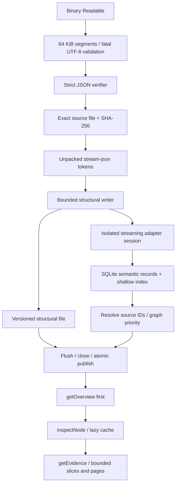

# Architecture and storage format



The source JSON is never assembled. Only manifests, signed cursors and bounded semantic row JSON use `JSON.parse`. SQLite temporary tables resolve arbitrarily many operation IDs without a JavaScript map of all operations. The example adapter holds a stack of open values and a fixed set of recognized fields per frame; scalar previews are limited to 1,024 UTF-16 units. Public semantic text previews are 256 units; structural key/path previews are 128 units.

## Filesystem boundary

```text
<configured root>/
  cursor.key                       # 32-byte HMAC key; atomically published
  staging/<capture UUID>/          # never read through public retrieval
  captures/<capture UUID>/
    source.json                    # exact binary input
    structure.bin                  # immutable structural representation
    evidence.sqlite                # immutable semantic records and seed index
    manifest.json                  # version, hashes, sizes, counts, metrics
  cache/<capture UUID>.sqlite      # mutable visited nodes and child checkpoints
```

Capture UUIDs are generated internally. Retrieval identifiers have the form `<UUID>:<record offset>`, with strict grammar and integer validation. The root offset is always 16. Every returned reference is backed by a structural record. Arbitrary offsets are validated against the parent/member lineage, unless already present in the trusted persisted sparse index. Cached offsets are derived from validated child enumeration. No caller-provided retrieval path is joined to the store.

`EvidenceStorage` controls stage, commit, discard, open, and cursor-key access. It currently supplies materialized local filenames to the compiler/retrieval modules. A remote blob implementation would need local staging/materialization; a Postgres metadata backend would additionally replace the SQL helpers/retrieval queries. These future backends are not implemented or claimed as drop-in adapters.

## Structural format v1

All offsets are absolute byte positions **in the structural file**, not source JSON offsets. The 16-byte file header is ASCII `ERCORE-TOK-v1` followed by three zero bytes. A value record begins with this 64-byte header:

| Byte offset | Encoding                 | Meaning                                                        |
| ----------- | ------------------------ | -------------------------------------------------------------- |
| 0           | uint32 LE                | Record magic `0xec0de001`                                      |
| 4           | uint8                    | Kind: object=0, array=1, string=2, number=3, null=4, boolean=5 |
| 5           | uint8                    | Boolean value, 0 or 1                                          |
| 6–7         | zero                     | Reserved                                                       |
| 8           | float64 LE, safe integer | End of this subtree, exclusive                                 |
| 16          | float64 LE, safe integer | Parent record offset; root is -1                               |
| 24          | float64 LE, safe integer | Zero-based member/array ordinal                                |
| 32          | float64 LE, safe integer | Immediate child count                                          |
| 40          | float64 LE, safe integer | Scalar code-unit/ASCII length                                  |
| 48          | uint32 LE                | Key length in UTF-16 code units                                |
| 52–55       | zero                     | Reserved                                                       |
| 56          | float64 LE, safe integer | Self-offset validation                                         |

The header is followed by UTF-16LE key bytes for object members (including empty keys), then the value's data. Strings are contiguous UTF-16LE and numbers contiguous ASCII. Object/array data is a sequence of child records; null/boolean need no data bytes. The parent kind distinguishes an empty object key from an array member. Duplicate keys remain separate records at separate offsets.

The writer tracks open frames, appends through a 64 KiB buffer, and patches completed headers in the buffer or staged file. Strings arrive in parser chunks and are encoded directly; escaped lone surrogates therefore remain intact even when source bytes and token chunks split differently. A child record's subtree end locates the next sibling without traversing its descendants. Closing a container finalizes its child count and end link. The file is frozen before publication.

## Index and graph database

`nodes` initially contains root, at most 50 root children, and semantic record offsets. `operations`, `relationships`, `failures` and `availability` preserve bounded source metadata and resolvable references. SQLite uses a 2 MiB configured page cache and disk-backed temporary storage. A single transaction spans staged ingestion and graph finalization; there is no in-memory transaction queue.

The illustrative adapter matches complete source ID strings up to 1,024 units, encoded as base64 UTF-16LE for exact SQLite matching, including NUL and lone-surrogate distinctions. Larger strings are preserved in structural storage but marked unresolved for matching. Source IDs need not be unique: groups with multiple operations produce ambiguous endpoints. Exact source relationships retain `parent`, `call`, `await`, `trigger`, `sequence`, or `dependency`. `parent`/`call` edges run from caller/parent to child. Failure status creates a failure record at its source status field; explicit failure-array records are also retained, even when both refer to the same operation.

After ingestion, SQL builds an indexed source-ID grouping, resolves endpoints, and assigns graph projection priorities. Failure operations come first, followed by ancestors connected through explicit parent/call relationships, directly connected operations, then source order. A recursive SQL union terminates even for recorded cycles. Relationship priority follows its endpoints, so incident edges are visible early. A focus query prioritizes its chosen operation and neighbors; it does not infer any additional links.

Generic graphs are `unavailable`. Example graphs are always `partial`: the illustrative format does not establish that every runtime relationship was captured. Source capture completeness means all received JSON was validated and committed, not that the runtime capture contains all facts about execution.

## Progressive retrieval

Inspection returns metadata and ordered child views; `depth` controls recursive expansion and `limit` is shared across that entire expansion. Child views at the requested depth boundary still carry a cursor for independent expansion. Response completeness measures the requested projection; it does not require descendants outside the requested depth to be expanded.

The lazy cache stores nodes and checkpoints encountered during inspection. Resuming from a checkpoint skips earlier siblings. The first arbitrary reference lookup can scan from the nearest checkpoint. Lazy indexing does not modify committed files. Cache writes are transactional; source evidence remains the authority.

Every graph, collection and inspection page has total, returned and remaining counts. Overview pages additionally have a signed `endCursor` even when exhausted, allowing all three lanes to advance independently. Scalar cursors carry a UTF-16-unit or number-lexeme offset. Page sizes/budgets are deliberately excluded from query binding, while identity, API, depth, part, and focus are included. HMAC signatures are compared in constant time. Cursor contents contain no raw evidence values.

Response limits use actual UTF-8 JSON serialization size. Containers return references rather than raw nested values; scalar slices shrink to fit. Preview fields include original lengths and references. Source truncation is separate from output pagination and follows the captured value subtree. If no record fits, `RESOURCE_LIMIT` is explicit. There are no silent cutoffs.

## Durability and operational boundaries

The original and structure files are fsynced, SQLite commits with `synchronous=FULL`, and the manifest is fsynced before same-filesystem directory rename. Readers only open `captures`. Killing a process before publication leaves an invisible stage; killing after rename leaves a readable committed capture. Tests exercise both boundaries and fresh-process access. The library does not guarantee directory metadata/power-loss persistence on every platform or filesystem, and does not automatically reap orphan stages.

Cancellation is checked while ingesting and immediately before publication. Once the atomic commit is entered, publication is the commit point; cancellation racing that point does not revoke a completed capture. Normal errors discard only the validated generated staging path. No user-provided directory is recursively removed.

The API never rewrites committed evidence. Filesystem owners and configured adapter implementations are trusted. On ordinary retrieval, length/format and structural boundaries are checked; same-size tampering requires the optional full `LocalEvidenceStorage.verify` hash pass. The manifest itself is not externally signed. No tenant isolation, encryption service or authentication layer is provided.

Node's synchronous SQLite API and bounded structural writes can block the event loop. Separate worker/process hosting is a caller concern. Metrics are numeric and error messages use fixed codes; routine library paths contain no logging of source values. The executable example deliberately prints its synthetic evidence for demonstration.
